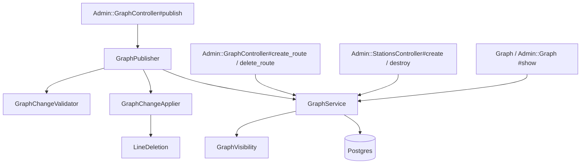

# Backend Internals

Last checked against commit `106ae55` on 10/13/26.

---

## Stack

| Concern | Choice |
|:--|:--|
| Language and framework | Ruby 3.4, Rails 7.2.3 (the Gemfile allows `~> 7.1`), API mode |
| Server | Puma |
| Database | Postgres (Supabase). `pg_trgm` supports station search. |
| Auth | Devise 5.0.4 and devise-jwt 0.13.0, `JTIMatcher` revocation |
| Cache | `Rails.cache`: Redis in production, memory in development and staging, null in test |
| Jobs | Sidekiq is installed. The repository has no job class and no `config/sidekiq.yml`. |
| Rate limiting | rack-attack 6.8.0 |
| CORS | rack-cors, origins from `ALLOWED_ORIGINS` |
| Object storage | Active Storage to Supabase S3-compatible storage |
| Pagination | Pagy 6.5.0 (used by `GET /api/v1/ar_world_maps` only) |
| Serialization | `as_api_json` on models, and `GraphService` for the graph |
| Tests | RSpec: request, service, model, and migration specs |

## Layout

```
app/
├── controllers/
│   ├── application_controller.rb   error rescues, paginate_meta
│   ├── health_controller.rb
│   └── api/v1/
│       ├── base_controller.rb      authenticate_user!, require_admin!, json_response, bust_graph_cache!
│       ├── graph_controller.rb     GET /graph, /graph/version (public)
│       ├── stations_controller.rb, routes_controller.rb (public)
│       ├── saved_routes, incidents, analytics, users, ar_world_maps
│       ├── auth/{sessions,registrations}_controller.rb
│       └── admin/
│           ├── graph_controller.rb          show, publish, create_route, delete_route
│           ├── graph_versions_controller.rb index, show
│           ├── stations, edges, lines, settings, analytics
├── models/                        17 models
└── services/
    ├── graph_service.rb           add_route, delete_route, insert_stop, remove_stop, graph assembly (1200 lines)
    ├── graph_publisher.rb         one transaction, one version
    ├── graph_change_validator.rb  shape check of each publish change
    ├── graph_change_applier.rb    one write for each change type
    ├── graph_visibility.rb        the visibility rule
    ├── line_deletion.rb           delete a line that nothing uses
    └── loop_reslicer.rb           rake task helper
lib/tasks/                         graph_repair.rake, stations.rake, assets.rake
```

## Services



| Service | Public entry | What it does |
|:--|:--|:--|
| `GraphService` | `.add_route`, `.delete_route`, `.insert_stop`, `.remove_stop`, `.assemble_graph`, `.assemble_admin_graph`, `.graph_version`, `.bump_version!`, `.polyline_distance_km` | Authors and assembles the graph. Each write runs in a transaction and raises the version. |
| `GraphPublisher` | `.publish(base_version:, changes:, user:)` | Validates, locks `graph_meta`, compares the version, applies all changes, raises the version once, writes `graph_versions`. |
| `GraphChangeValidator` | `#call` | Checks shape and values. Returns clean changes and every error. Makes no database read. |
| `GraphChangeApplier` | `#apply(change)` | Writes one change. Raises `Rejected` for a missing row or a broken rule. |
| `GraphVisibility` | `#station_visible?`, `#edge_visible?`, `#line_visible?`, `#line_id_visible?`, `#station_id_visible?` | The visibility rule. |
| `LineDeletion` | `.call(line_id)`, `.delete!(line_id)` | Deletes a line with no stop and no edge. Removes its fare rows and mode entry. |

### `GraphService#add_route`

`validate` checks the payload. `normalize_passes` turns the flat shape and the `passes` shape into one list. The transaction then:

1. Locks the `lines` row (`lock_line!`) and reads `last_stop_number`.
2. Builds stops (`<CHAIN>_S<n>`) and edges (`<FROM>__<TO>`).
3. Upserts stations and edges.
4. Appends the line ID to `transport_modes.lines`.
5. Updates the `lines` row.
6. Raises the graph version.

Travel time: a road edge of 5 km or more runs at 45 km/h. A shorter edge uses 22 km/h (bus), 16 km/h (jeepney), 15 km/h (tricycle), or 30 km/h (train). The minimum is 2 minutes.

### `insert_stop` and `remove_stop`

| Rule | Reason |
|:--|:--|
| Refuse a stop with `type` `train`. | MRT and LRT stops serve both directions. |
| Accept a stop whose ID ends in `_S<n>` or `_STOP<n>` only. | The chain comes from the ID prefix. |
| A closed loop works. The closing edge is an ordinary segment. | The code wraps around the loop. |
| Refuse a remove when the chain has 2 stops or fewer. | A route needs 2 stops. Delete the route. |

Both methods change `stations.sequence` and line edges. They never rename a stop or an edge. A retry of an insert returns the stop that already exists (same name within 5 m).
Specs: `spec/services/graph_service_stop_editing_spec.rb`, `graph_service_loop_stop_editing_spec.rb`, `graph_service_insert_stop_polyline_spec.rb`, `graph_service_insert_stop_retry_spec.rb`.

## Auth

See [Security](security.md#authentication) for the token lifetime, revocation, and refresh flow.

## Caching

| Key | TTL | Busted by |
|:--|:--|:--|
| `full_graph` | 5 min | `bust_graph_cache!` |
| `graph_version` | 30 s | `bust_graph_cache!` |
| `routes_index` | 30 min | Nothing. Migrations 022 to 026 delete it. |
| `stations/<line>/<type>/<interchange>/<search>` | 1 h | `bust_graph_cache!(extra_pattern: "stations*")` from station writes and publish |

`bust_graph_cache!` rescues every error and logs it. A cache failure cannot turn a committed write into a failed response. The worst case is stale data until the TTL ends.

## Deployment

`render.yaml`:

```yaml
type: web · runtime: ruby · region: singapore · plan: starter
buildCommand:     bundle install
preDeployCommand: bundle exec rails db:migrate
startCommand:     bundle exec puma -C config/puma.rb
healthCheckPath:  /health
```

Environment variable keys: `DATABASE_URL`, `SECRET_KEY_BASE`, `DEVISE_JWT_SECRET_KEY`, `REDIS_URL`, `ALLOWED_ORIGINS`, `HONO_API_URL` (unused), `BOOTSTRAP_ADMIN_PASSWORD`, `BOOTSTRAP_DEV_PASSWORD`, `SUPABASE_S3_*`, `SUPABASE_STORAGE_BUCKET`, `RAILS_SKIP_ASSET_COMPILATION`.

> **Warning:** Seeds do not run on deploy. The pipeline runs `db:migrate` only. Put data that the app needs in a migration.

> **Note:** The `starter` plan stops the service when idle. A cold request takes about 44 seconds.

The repository also has `railway.toml` and a Procfile. Render does not use them.

## Local development

```bash
bundle install
bin/rails db:create db:migrate
bin/rails server            # http://localhost:3000
bundle exec rspec           # use a disposable database
```

Set `DATABASE_URL`, `DEVISE_JWT_SECRET_KEY`, and optionally `REDIS_URL` and `ALLOWED_ORIGINS` in `.env`. See [Agent Guide](agent-guide.md#run-the-specs-safely) before you run the specs.

## Migration history

| # | Purpose |
|:--|:--|
| 001 to 008 | Extensions, users, saved routes, AR maps, route plan events, incidents, Active Storage, trigram indexes |
| 009 | Graph tables: `graph_meta`, `transport_modes`, `payment_methods`, `peak_hour_config`, `fare_matrix`, `stations`, `edges` |
| 010, 012 | `enforce_operating_hours` on `graph_meta` |
| 011 | Bootstrap admin users and the `graph_meta` row |
| 013, 015 | `is_road_snapped` on edges, and a backfill |
| 014 | Primary keys on graph tables |
| 016 | Corrected rail station coordinates |
| 017, 020 | `station_access_points`, and a deferred foreign key |
| 018, 019 | `lines` table, and a version bump |
| 021 | `stations.sequence` and `lines.last_stop_number` |
| 022 | Renamed lines (`MRT-3` to `MRT3`, `EDSA_BUS` to `EDSA_CAROUSEL`, and others) |
| 023, 024 | Recalculated road edge times |
| 025 | `lines.color_hex` |
| 026 | `stations.boarding` |
| 027 | `enabled` and `disabled_reason` on lines, stations, edges |
| 028 | `lines.base_km` and `lines.direction` |
| 029 | `rail_fare_tables` |
| 030 | `graph_versions` |

## Known issues

Found by reading the code at commit `106ae55`. "Not verified" means the issue needs a run time or live data check.

| # | Issue | Where | Effect |
|:--|:--|:--|:--|
| 1 | `paginate_meta` calls `pagy.limit`. Pagy 6.5.0 has `items`, not `limit`. | `app/controllers/application_controller.rb:33`, used at `ar_world_maps_controller.rb:15` | `GET /api/v1/ar_world_maps` raises `NoMethodError` (500). No spec covers it. |
| 2 | Routes without a controller: `places`, `events`, `admin/users`, `admin/ar_world_maps`, `admin/incidents`. | `config/routes.rb:59-60` and `64-66` | A request raises a routing error. |
| 3 | Six INTERCHANGE edges point to stations that do not exist. | Data. Source: the ops note of 10/12/26. | The public graph leaves them out. The admin graph lists them. Not verified (no database access). |
| 4 | Seven empty lines from migration 018 have no stops. | Data. `db/migrate/018_create_lines.rb:35-52` (the file names `EJEEPNEY_BGC` as one) | Empty lines show in the admin graph. Not verified (no database access). |
| 5 | Public `GET /stations`, `/stations/:id`, `/routes`, `/routes/:line_id` ignore `enabled`. | `stations_controller.rb:10-16`, `routes_controller.rb:9-55` | Hidden stops and lines still show in these responses. |
| 6 | The `routes_index` cache is never deleted by a write. | `routes_controller.rb:9`, `base_controller.rb:41-47` | `stop_count` and fares stay stale for up to 30 minutes. |
| 7 | `PATCH /admin/settings` does not raise the graph version. | `admin/settings_controller.rb:17-21` | The graph JSON carries `enforceOperatingHours`. A client with the same version does not re-download. |
| 8 | Account delete fails for a user who has `route_plan_events`. The foreign key has no `ON DELETE`, and `User` has no `dependent` for it. | `db/schema.rb` (`add_foreign_key "route_plan_events", "users"`), `app/models/user.rb:11-12` | `DELETE /api/v1/auth/account` returns 500. Not verified at run time. |
| 9 | `POST /api/v1/incidents` with an unknown `category` raises `ArgumentError`. | `incidents_controller.rb:12`, `models/incident.rb:4` | 500 instead of 422. |
| 10 | `ArWorldMap#as_api_json(include_url: true)` calls `rails_blob_url` with `only_path: false`. No default host is set. | `models/ar_world_map.rb:24`, `config/` | `GET /api/v1/ar_world_maps/:id` can raise for a map with a file. Not verified. |
| 11 | `config/puma.rb` and `config/sidekiq.yml` are not in the repository. | `render.yaml:9`, `Procfile:1-2` | Start command names a missing file. Not verified how Render starts. |
| 12 | `PATCH /admin/stations/:id` does not validate `lat`, `lng`, `open_time`, or `close_time`. | `admin/stations_controller.rb:109-125` | A bad number stores as `0.0`. Bad hours store as text. |
| 13 | `PATCH /admin/edges/:id` accepts any `direction` string. | `admin/edges_controller.rb:66-84` | A wrong label can enter the graph. |
| 14 | `CLAUDE.md`, `README.md`, `.env.example`, `railway.toml`, and `render.yaml` still name the Hono service, Koyeb, or Railway. | Repository root | Misleads readers. No code reads `HONO_API_URL`. |
| 15 | `graph_service.rb` is 1200 lines. | `app/services/graph_service.rb` | Over the 500-line limit of the project style. |
| 16 | `GraphService` uses string interpolation in two `update_all` calls. | `graph_service.rb:272`, `326` | See [Security](security.md#sql-safety). |

See also the gaps in [Security](security.md#known-gaps).
