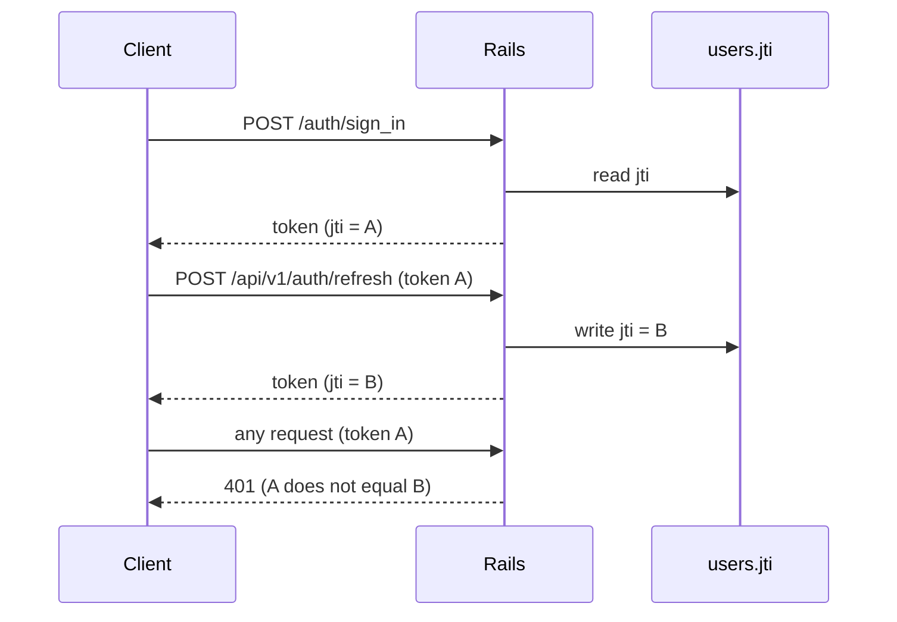

# Security

Last checked against commit `106ae55` on 10/13/26.

---

This page states how the backend protects access and data. It names environment variables by key only. Never write a value in the documentation.

## Authentication

| Item | Value | Source |
|:--|:--|:--|
| Library | Devise 5.0.4 with devise-jwt 0.13.0 | `Gemfile.lock` |
| Token type | JWT, signed with `DEVISE_JWT_SECRET_KEY` | `config/initializers/devise.rb` |
| Token lifetime | 24 hours | `jwt.expiration_time` |
| Token dispatch | `POST /auth/sign_in`, `POST /auth/register` | `jwt.dispatch_requests` |
| Revocation request | `DELETE /auth/sign_out` | `jwt.revocation_requests` |
| Revocation strategy | `JTIMatcher`: the `jti` claim must equal `users.jti` | `app/models/user.rb` |
| Password storage | bcrypt (`encrypted_password`) | Devise `database_authenticatable` |
| Password rules | Devise defaults (6 to 128 characters). No custom rule. | `validatable` |

### Revocation

All tokens of one user share one `users.jti`. A new sign in does not change it. Two devices can hold valid tokens at the same time.
Sign out and refresh both replace `users.jti` with a new UUID. Every older token of that user stops working.

### Refresh flow

1. The client sends `POST /api/v1/auth/refresh` with a valid, unexpired token.
2. The server runs `update_column(:jti, SecureRandom.uuid)`.
3. The server encodes a new token with the new `jti` and returns it.

The server refuses an expired token. The client must refresh before 24 hours pass.

## Roles and admin access

`users.role` is an enum: `commuter` (0) and `admin` (1). New accounts are `commuter`. The registration form does not permit `role`.

| Layer | Rule |
|:--|:--|
| `Api::V1::BaseController` | `before_action :authenticate_user!` for every action. Public controllers call `skip_before_action :authenticate_user!`. |
| `BaseController#require_admin!` | Returns 403 when `current_user&.admin?` is false. |
| Each admin controller | Declares `before_action :require_admin!` itself. |

There is no shared admin base controller. A new controller in `app/controllers/api/v1/admin/` must declare `require_admin!` first, before any lookup callback. The admin controllers `analytics`, `edges`, `graph`, `graph_versions`, `lines`, `settings`, and `stations` all do.

The server creates the first admin accounts in migration 011. The passwords come from `BOOTSTRAP_ADMIN_PASSWORD` and `BOOTSTRAP_DEV_PASSWORD`. When a variable is unset, the migration generates a password and writes it to the log.

## Rack::Attack

Source: `config/initializers/rack_attack.rb`. The cache is Redis when `REDIS_URL` is set, and memory otherwise. A memory store counts per process.

| Throttle | Limit | Key | Match |
|:--|:--|:--|:--|
| `auth/ip` | 10 per 20 s | `req.ip` | Path starts with `/auth/` |
| `auth/email` | 5 per 5 min | `req.params["user"]["email"]`, lower case | `POST /auth/sign_in` |
| `api/ip` | 60 per 1 min | `req.ip` | Path starts with `/api/` |
| `analytics/user` | 30 per 1 min | Last word of `HTTP_AUTHORIZATION` | `POST /api/v1/analytics/route_plan` |

A throttled request gets 429 and `{ "error": "Too many requests. Please try again later." }`.

Notes:

- `auth/email` reads `req.params`. Rack parses form bodies only. For a JSON body, the key is `nil`, so the throttle probably never fires. No spec covers it.
- `/health`, `/password`, and `/rails/*` have no throttle.
- The `analytics/user` key is the token itself. The token is stored as a cache key in Redis.
- `spec/support/rack_attack.rb` swaps in a memory store and resets the counters for each example.

## CORS

Source: `config/initializers/cors.rb` (rack-cors).

| Setting | Value |
|:--|:--|
| Origins | `ALLOWED_ORIGINS` (comma list). The default is `*` when the variable is unset. |
| Resource | `*` |
| Methods | `get post put patch delete options head` |
| Headers | any |
| Exposed headers | `Authorization` |
| Max age | 600 s |

The API uses bearer tokens and no cookies, so a wildcard origin does not expose a session. Set `ALLOWED_ORIGINS` in production anyway. `render.yaml` marks it `sync: false`, so Render does not set a value.

## Input validation

### Graph IDs

| Rule | Where |
|:--|:--|
| New line ID: `^[A-Z][A-Z0-9]*(_[A-Z0-9]+)*$` | `GraphService::NEW_LINE_ID_RE` |
| Existing line ID: `^[A-Z0-9_.]+$` | `GraphService::LEGACY_LINE_ID_RE` |
| New ID in a publish change (`access_point_id`) | `GraphChangeValidator::NEW_ID_RE` |
| Reference ID in a publish change: no white space, 1 to 120 characters, and the row must exist | `GraphChangeValidator#clean_reference_id` |
| Transfer end stops must match the new ID rule | `GraphChangeValidator#check_transfer_ends` |
| Route params carry the ID unchanged, dots included | `GRAPH_ID` in `config/routes.rb` |
| Color: `#RRGGBB` | `Line::COLOR_HEX_FORMAT` |
| Time: `HH:mm` | `GraphService::TIME_RE` |

`GraphService#insert_stop` and `#remove_stop` accept only stop IDs that end in `_S<n>` or `_STOP<n>`.

### Other validation

| Input | Rule |
|:--|:--|
| Publish body | JSON object. 1 to 2000 changes. Unknown fields are errors. Numbers must be JSON numbers. |
| Edge update | `bidirectional` and `direction` cannot both apply. `direction` is a free string. |
| Station update | `name`, `short_name`, `open_time`, `close_time` are trimmed only. No format check. |
| Access point | `kind`, `direction`, `lat`, and `lng` are validated in the model and by database check constraints. |
| Incident `category` | Enum. A value outside the list raises an error (500). |
| `POST /auth/register` | Strong params: `email`, `password`, `password_confirmation`, `display_name` (60 characters at most). |

### SQL safety

- Controllers and services use Active Record queries with bound values. `Station.search` binds `q`.
- `GraphService#add_route` (line 272) and `#delete_route` (line 326) build `array_append` and `array_remove` SQL by string interpolation. The code doubles single quotes. The route layer or the ID rule limits the value. Bind the value in a later change.
- `GraphService#ordered_chain` passes `Regexp.escape(prefix)` as a bound value to a Postgres `~` match.
- Migrations that run raw SQL use `quote`.

## Secrets handling

| Variable | Used for | Set by |
|:--|:--|:--|
| `DEVISE_JWT_SECRET_KEY` | JWT signing. The app fails at boot when it is missing. | Render, `sync: false` |
| `SECRET_KEY_BASE` | Rails secret | Render, generated |
| `DATABASE_URL` | Postgres connection | Render, `sync: false` |
| `REDIS_URL` | Cache and Rack::Attack | Render, `sync: false` |
| `SUPABASE_S3_ENDPOINT`, `SUPABASE_S3_ACCESS_KEY`, `SUPABASE_S3_SECRET_KEY` | Active Storage | Render, `sync: false` |
| `SUPABASE_S3_REGION`, `SUPABASE_STORAGE_BUCKET` | Active Storage | `render.yaml` |
| `BOOTSTRAP_ADMIN_PASSWORD`, `BOOTSTRAP_DEV_PASSWORD` | Migration 011 only | Render, `sync: false` |
| `ALLOWED_ORIGINS` | CORS | Render, `sync: false` |
| `HONO_API_URL` | Not read by any code. | Listed in `render.yaml` and `.env.example` |

Rules:

- `.env` is in `.gitignore`. Never open, print, or commit it.
- Never write a token, password, or database URL in a document, a log, or a commit message.
- The iOS app keeps the token in the Keychain.

## File uploads

| Item | Value |
|:--|:--|
| Endpoint | `POST /api/v1/ar_world_maps`, multipart, key `map_file` |
| Size cap | 150 MB (`MAX_UPLOAD_BYTES`). The check runs before `attach`. Result: 413. |
| Content type check | None. The gem `active_storage_validations` is installed and unused. |
| Storage | Disk locally. Supabase S3 in production and staging (`config/storage.yml`). |
| Review | A new map has status `pending`. Only an admin sees a pending map. |

Rack and Puma set no separate body limit in the repository.

## Known gaps

| Gap | Where | Risk |
|:--|:--|:--|
| No `filter_parameters` setting. `password` can appear in request logs. | `config/` (no `filter_parameter_logging.rb`) | Credentials in logs. Check a log sample. |
| Migration 011 writes a generated password to the log. | `db/migrate/011_bootstrap_admin_and_graph_meta.rb` line 15 | Secret in logs. |
| `auth/email` throttle does not read a JSON body. | `config/initializers/rack_attack.rb` line 22 | Password guessing per account is limited by `auth/ip` only. |
| Active Storage `POST /rails/active_storage/direct_uploads` is mounted with no authentication. | Rails default routes | Anyone can create blobs. Not verified at run time. |
| Action Mailbox and Conductor routes are mounted. | `rails/all` in `config/application.rb` | Extra surface. Not verified at run time. |
| No `force_ssl`. Render ends TLS. | `config/environments/production.rb` | The app does not redirect plain HTTP. |
| Error bodies include exception text. | `graph_controller.rb` lines 14 and 26, `registrations_controller.rb` line 40, `GraphService` rescue blocks | Internal detail leaks. |
| `require_admin!` is repeated in each admin controller. | `app/controllers/api/v1/admin/` | A new controller can miss it. |
| `ALLOWED_ORIGINS` default is `*`. | `config/initializers/cors.rb` | Open CORS when unset. |
| `/password` routes exist and no mailer is configured. | `config/routes.rb` (`devise_for`), `User` has `:recoverable` | Reset flow fails or errors. Not verified. |
| No content type check on AR map uploads. | `ar_world_maps_controller.rb` | Any file type is stored. |
| `PATCH /api/v1/admin/stations/:id` does not check `lat`, `lng`, or hours format. | `admin/stations_controller.rb` lines 109 to 125 | A bad value stores as `0.0` or free text. |
